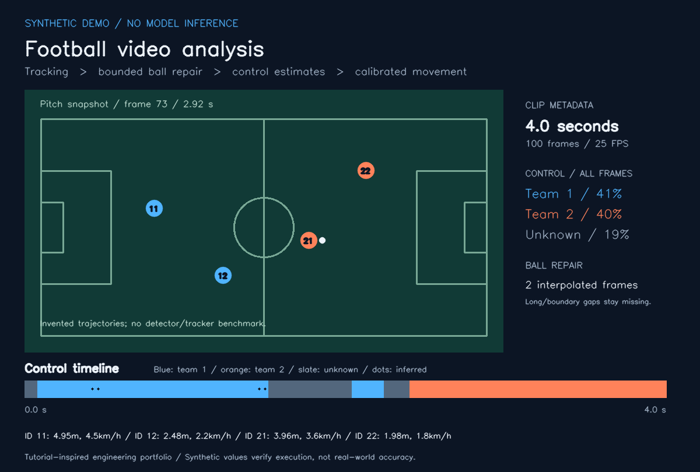

# Football Video Analysis

A tutorial-inspired computer-vision portfolio project: replay tracking data, repair short ball gaps, estimate proximity-based control, and calculate movement in explicitly calibrated pitch coordinates. A complete **synthetic demo runs offline with Python alone**. Optional local YOLO + ByteTrack inference and annotated AVI export are separate paths.

Portfolio by **[Ata Yunus Ortak](https://github.com/ata-yunus-ortak)**. Tutorial architecture is credited to Abdullah Tarek / codeinajiffy below.



**The public example is invented.** It demonstrates software behavior, reporting, and edge-case handling. It is not a detector benchmark, a real match analysis, a trained model, or evidence of scientific measurement accuracy.

## Run in one minute

Python 3.10 or later is required for the offline workflow. From the repository root:

```bash
python -m football_video_analysis demo --out outputs/demo
python -m unittest discover -s tests -v
```

No footage, weights, API keys, pip installation, or network access is needed. To explicitly verify independence from third-party packages:

```bash
python -S -m football_video_analysis demo --out outputs/offline
```

Open `outputs/demo/report.svg` in a browser. Outputs also include `tracks.json`, `config.json`, `summary.json`, `control.csv`, and `movement.csv`. Generated files stay under the ignored `outputs/` directory. The [public SVG report](assets/synthetic-demo.svg) and [expected summary](examples/synthetic_summary.json) are included for review.

Replay the supplied JSON sample without initializing a detector:

```bash
python -m football_video_analysis analyze --tracks examples/synthetic_tracks.json --config examples/synthetic_config.json --out outputs/replay
```

## What the repository demonstrates

- Modular Python design: tracking interchange, validation, geometry, analysis, reporting, CLI, and optional video/inference adapters.
- Practical handling of missing detections: bounded interpolation, explicit unknown control, short carrying intervals, and observable data-quality states.
- Computer-vision integration: local YOLO predictions, ByteTrack identities, jersey-color heuristics, optical-flow translation, and calibrated projection.
- Reproducibility: deterministic inputs, readable JSON/CSV outputs, regression tests, and GitHub Actions for offline and video workflows.
- Publication hygiene: no provider footage, dataset, trained weights, training notebook, pickle cache, or credentials in the repository.

## Optional video export

The video runtime is pinned for Python 3.10–3.12. A fresh virtual environment is recommended:

```bash
python -m venv .venv
# Windows PowerShell: .venv\Scripts\Activate.ps1
# macOS/Linux: source .venv/bin/activate
python -m pip install -r requirements-video.txt
python -m football_video_analysis demo --render-video --out outputs/video-demo
```

This creates `synthetic.avi` (MJPG), `preview.png`, `dashboard.png`, and the same analysis reports. The test suite decodes the generated AVI and checks all 100 frames, 25 FPS metadata, and 960 × 640 dimensions. Playback uses the declared constant frame rate; arbitrary variable-frame-rate timestamps are not preserved.

## Optional inference on your own clip

Install the larger inference stack only if you have a trusted, compatible local model and footage you may use:

```bash
python -m pip install -r requirements-inference.txt
python -m football_video_analysis infer --video videos/clip.mp4 --model models/local-football.pt --config examples/video_config.json --max-frames 300 --device cpu --out outputs/inference --render-video
```

No model or footage is downloaded automatically. The model must have exact class names `player` and `ball`; `referee` and `goalkeeper` are optional. General-purpose models with only `person` are incompatible. `.pt` files use executable model serialization: load only weights from a source you trust. The new repository does not include training or claim ownership of a detector.

`examples/video_config.json` intentionally starts with no team colors and no calibration. This gives unknown teams and omits metric movement until you configure the clip. Set both BGR jersey reference colors to enable the central-shirt median-color heuristic, and use explicit `team_overrides` when needed. Goalkeepers stay unassigned unless overridden. There are no fixed track-ID exceptions.

For movement, set four `pixel_points` and their matching `pitch_points_m` in convex perimeter order. Use measured reference points for that camera view; see [configuration and interchange documentation](docs/FORMAT.md). The synthetic calibration is valid only for the synthetic scene. Recalibrate after cuts or changes of view.

For a simple translating camera, `--camera-motion` estimates cumulative optical-flow displacement. Without this flag the camera is assumed static. This approximation does not handle zoom, rotation, perspective changes, or cuts. If optical-flow features fail, the cumulative reference is marked invalid for the rest of the clip and metric segments are withheld.

Inference decodes one frame at a time and is limited to 300 frames by default. Tracking records remain in memory; the cache reader has a 20 MB limit, so use short clips. Run `python -m football_video_analysis infer --help` for options. Pin files list direct dependencies, not every transitive dependency or CUDA environment.

Replay a private inference cache and annotate its original source without loading weights:

```bash
python -m football_video_analysis analyze --tracks outputs/inference/tracks.json --config examples/video_config.json --video videos/clip.mp4 --out outputs/replay-video
```

Video caches store the source SHA-256 and metadata. Rendering refuses a different source or FPS/dimension mismatch. Generated outputs cannot overwrite input tracks, configuration, model, or source video. Private cached tracking can itself reveal match data; keep it outside published assets.

## Behavior and limitations

**Control** means the nearest eligible player's bounding-box foot corner within a configurable pixel threshold. It is a proximity heuristic, not football event possession or a rules-aware measure. Equally close candidates and players without a known team yield unknown. A visible loose ball resets control. A missing ball can carry the previous visible owner for two frames, then becomes unknown. Reports distinguish observed, interpolated, carried, and unknown frames.

**Ball repair** fills only interior gaps no longer than the configured limit (three frames by default). Leading, trailing, all-missing, and long gaps remain missing. Interpolated boxes are marked. The best-confidence ball detection is used; there is no multi-ball association model.

**Movement** uses foot positions projected through a supplied homography, after any cumulative translation adjustment. Out-of-calibration points, absent players, and invalid camera frames break continuity. Segments exceeding the configured 45 km/h threshold are flagged and excluded. This threshold is a guard, not a validated outlier model. Adjacent-frame measurement is noisy, and distance undercounts missing/rejected segments. The `valid_segments` field must be considered alongside totals. A single frame cannot establish speed.

**Video timing** uses source FPS metadata consistently for durations, speed, tracking, and output. It assumes a constant frame rate. Transcode variable-frame-rate inputs before analysis. Stable tracking IDs, camera assumptions, team configuration, calibration, detection noise, and occlusion all affect the result. No precision, recall, MOTA, IDF1, possession accuracy, or movement error has been measured here. Full-match and real-time performance are unvalidated.

## Synthetic example results

The reproducible example contains four players over 100 frames at 25 FPS (4 seconds):

| Output | Expected value |
|---|---:|
| Team 1 / all frames | 41% |
| Team 2 / all frames | 40% |
| Unknown / all frames | 19% |
| Known control coverage | 81% |
| Observed / interpolated / carried / unknown frames | 77 / 2 / 2 / 19 |
| Interpolated ball frames | 2 |
| ID 11 movement over 99 valid segments | 4.95 m, max 4.5 km/h |

Known-only percentages are also exported with their denominator and coverage; they should not hide the unknown interval. These expected numbers verify an invented trajectory and cannot assess real-world accuracy.

## Individual implementation changes

This repository is a new implementation inspired by the local tutorial-based project. It replaces single-clip hardcoded settings and fragile cache assumptions with a reproducible public workflow:

| Earlier local implementation | This repository |
|---|---|
| Requires `models/best.pt` even for a cached replay | Offline JSON replay has no model import or weight requirement |
| Pickle tracking/camera stubs | Validated JSON with finite coordinates, frame counts and source fingerprints |
| First unassigned ball reads an empty history | Starts explicitly unknown and reports unknown duration |
| Speed/export assume 24 FPS | Uses declared/source FPS; synthetic regression uses 25 FPS |
| One camera polygon and special team IDs | Per-video calibration, jersey colors and explicit optional overrides |
| Unbounded interpolation and backfilling | Short interior gaps only, with inference markers |
| Previous team carried indefinitely | Limited grace; absent owner, visible loose ball and ambiguity return unknown |
| Sparse runtime safeguards | Input collision checks, empty-video errors, optical-flow failure handling, tests and CI |

## Tests and repository map

```text
football_video_analysis/   analysis, geometry, config, JSON format, reporting, CLI
                          optional inference.py and video.py
examples/                 invented tracking, calibration, expected results
assets/                   generated synthetic preview and SVG report
tests/                    regression, CLI replay and optional video roundtrip
docs/                     format, provenance, third-party notices, verification
.github/workflows/        Python 3.10/3.12 offline tests + optional OpenCV job
```

The offline suite runs without site-packages. Optional video tests run when OpenCV and NumPy are installed, otherwise skip. See [verification notes](docs/VERIFICATION.md) for exactly what was executed and what remains untested. GitHub Actions results are available after the first pushed run.

## Attribution, provenance and license

The module-level idea—YOLO/ByteTrack, shirt color, ball proximity, camera compensation, perspective transformation, and movement overlays—was learned from **Abdullah Tarek / codeinajiffy** and his [football-analysis tutorial work](https://github.com/abdullahtarek/football_analysis), with the [codeinajiffy YouTube channel](https://www.youtube.com/@codeinajiffy) credited in the local source. This portfolio does not present that architecture as an original research contribution. Public code here was rewritten; original notebook, dataset, weights, pickle stubs and footage are excluded. See [provenance](docs/PROVENANCE.md).

New repository code and invented demo assets are covered by the [MIT License](LICENSE). This does not relicense the tutorial, dependencies, footage, datasets, or models. Optional Ultralytics use is subject to its own [AGPL-3.0 or Enterprise terms](https://www.ultralytics.com/license); evaluate the corresponding obligations for your complete application. See [third-party notices](docs/THIRD_PARTY.md).

Companion project: [Football Possession & xG Analysis](https://github.com/ata-yunus-ortak/football-possession-xg-analysis), which explores event-data analysis separately from this video-tracking workflow.
